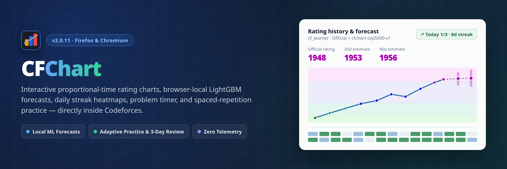
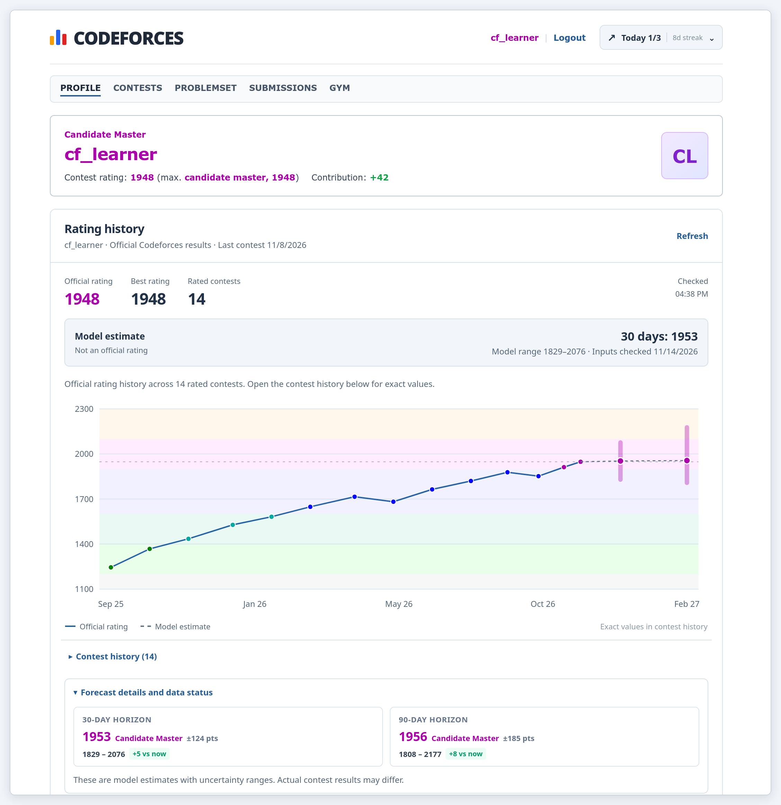
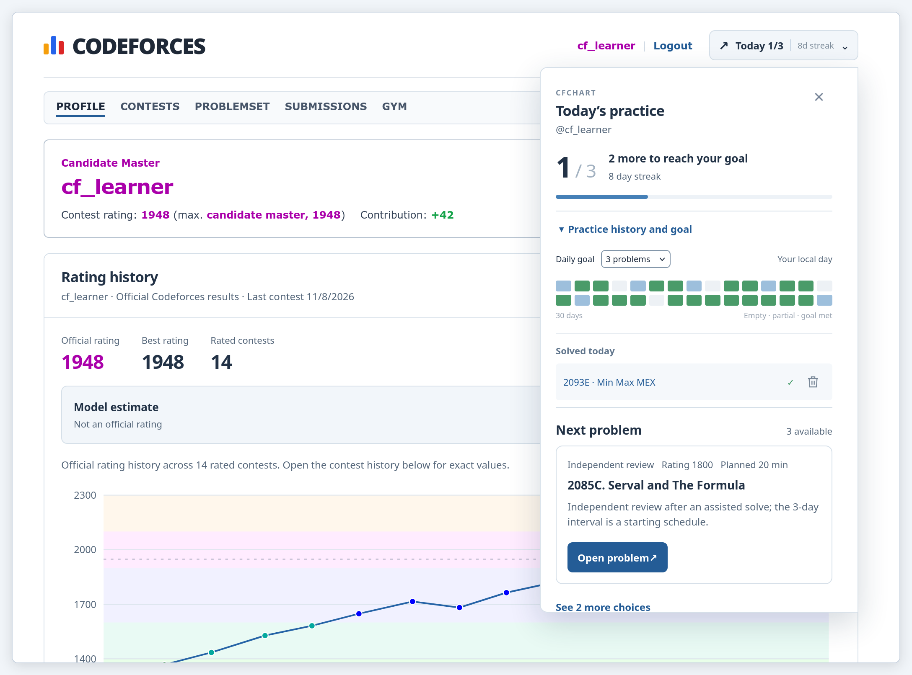
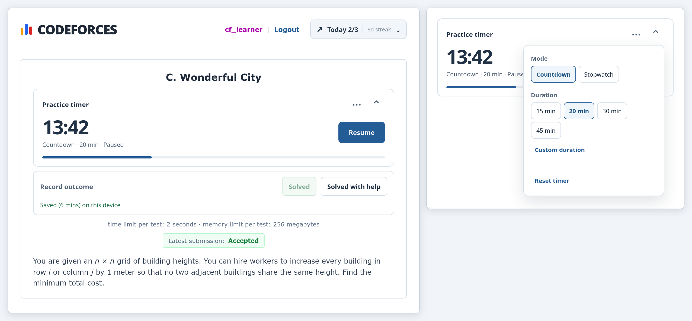
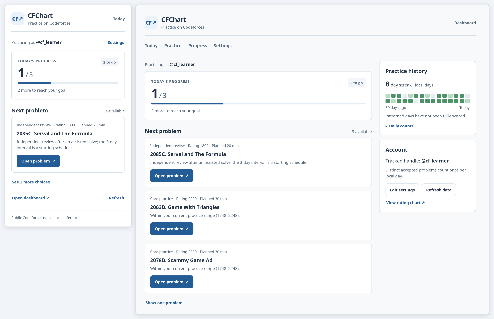
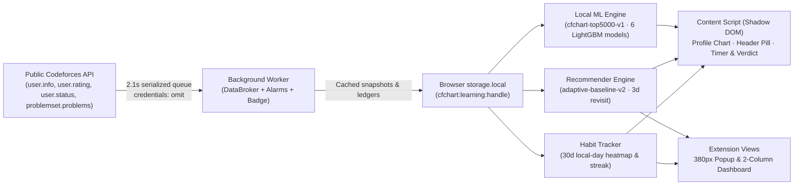

<div align="center">



<h3>Interactive Codeforces Rating Charts, Browser-Local ML Forecasts &amp; Adaptive Practice</h3>

<p>
  <strong>v2.0.11</strong> &middot;
  Firefox 140+ &amp; Chromium (Chrome, Brave, Edge) &middot;
  100% Browser-Local Inference &middot;
  Zero Telemetry
</p>

<p>
  <a href="#features--screenshots">Features</a> &middot;
  <a href="#installation">Installation</a> &middot;
  <a href="#architecture--data-flow">Architecture</a> &middot;
  <a href="#machine-learning-forecast-pipeline">ML Pipeline</a> &middot;
  <a href="#development--testing">Development</a> &middot;
  <a href="PRIVACY.md">Privacy Policy</a>
</p>

</div>

---

**CFChart** is a Manifest V3 browser extension for **Firefox** (including Zen, LibreWolf, Floorp, and Waterfox) and **Chromium-based browsers** (Chrome, Brave, Edge) that embeds proportional-time rating charts, on-device LightGBM rating forecasts, a 30-day practice streak tracker, an in-page problem timer, and a spaced-repetition recommender directly inside Codeforces — without any external server, login credentials, or tracking.

---

## Features & Screenshots

### 1. Interactive Profile Rating Chart & Local ML Forecasts

<p align="center">
  
</p>

* **Proportional time axis:** Replaces Codeforces' default evenly-spaced contest spacing with a numeric timestamp SVG chart (`HorizonChart`) showing real training intervals across **10 Codeforces rank bands** (`Newbie` to `Legendary Grandmaster`, with Master starting at `2100` and International Master at `2300`).
* **Complete contest summary:** Displays **Official rating**, **Best rating**, **Rated contests**, check timestamp, a collapsible **Contest history** table, and automatic fallback to Codeforces' native `#userRatingGraphHolder` on unrated profiles or load errors.
* **Browser-local ML forecasts (`cfchart-top5000-v1`):** Computes **30-day** and **90-day** rating point estimates (`Model estimate — Not an official rating`) plus asymmetric quantile uncertainty bars (`[5th, 50th, 95th]` for 30d and `[4th, 50th, 96th]` for 90d) directly in TypeScript once at least **3 rated contests** and **90 days** of submission coverage are available.
* **Incremental backfill:** Includes a **Sync more forecast history** action when an account's 90-day practice window is only partially loaded, pulling one older page (`1,000` submissions) per click without flooding the API.

---

### 2. Top-Bar Habit Pill & 30-Day Streak Flyout

<p align="center">
  
</p>

* **Persistent header pill:** Injects `Today X/Y | Xd streak` into the Codeforces navigation bar across profile, contest, and problemset pages, synced with the extension toolbar badge (`✓` when the daily goal is met).
* **30-day local-day heatmap:** Click the pill to inspect empty, partial, goal-met, and partially-synced (patterned) days across the last **30 local calendar days**, plus a quick selector to change your daily problem goal (`1–5` problems in the flyout; `1–10` in the popup/dashboard).
* **Universal counting & instant cleanup:** Distinct accepted problems (`OK`) anywhere on Codeforces count once per local day toward your streak and daily goal, appear under **Solved today** with direct links and a remove icon, and sit directly above your top **Next problem** card.

---

### 3. In-Page Practice Timer & Accepted-Only Outcome Bar

<p align="center">
  
</p>

* **Countdown & Stopwatch modes:** Embedded on `/problemset/problem/...`, `/contest/.../problem/...`, and `/gym/.../problem/...` pages. Choose **Countdown** (`15`, `20`, `30`, `45 min` presets or custom `1–1440 min` — remembering your last chosen countdown duration in `localStorage`) or open-ended **Stopwatch** mode.
* **Reload-safe & collapsible:** Collapses into a slim control strip while keeping live time and Start/Pause/Resume controls accessible. Countdown expiry surfaces an inline **Time limit reached** banner with quick **+5 min** and **Continue** actions, while active sessions log pause/resume intervals locally (`sessionStorage` + background ledger).
* **Accepted-only verdict bar:** Appears automatically once your tracked account has an accepted submission for that problem (from synced history or live `.verdict-accepted` on the page when signed into the same handle). Logging **Solved** or **Solved with help** auto-saves elapsed timer time (`>= 1 min` / `30+ sec`), pauses the running timer, and — for assisted solves — schedules an **Independent review** slot in **3 days**.

---

### 4. Popup, Two-Column Dashboard & Adaptive Practice Recommender

<p align="center">
  
</p>

* **Focused 380px popup & two-column dashboard:** The popup puts **Today's progress** and your single top **Next problem** first (`See N more choices` / `Open dashboard ↗`), while the full-page **Dashboard** expands into a responsive two-column workspace with **Today**, **Practice**, **Progress** (30-day heatmap + expandable **Daily counts**), and **Account** / **Settings** (daily goal `1–10`, daily practice budget `20–240 min`, data refresh, and JSON export/reset).
* **`adaptive-baseline-v2` recommender:** Selects candidates within `[target - 200, target + 300]` from finished contests (filtering out solved problems and applying a 7-day cooldown on recently skipped/shown items), **prefers problems from contests within the last 3 years** (falling back to older problems if recent inventory is thin), and packs slots (**Independent review**, **Upsolve**, **Core practice**, **Stretch**) inside your daily time budget while diversifying tags and contests.
* **Goal-independent spaced repetition:** Assisted solves return for **Independent review** after **3 days** (and explicitly skipped problems retry after **7 days**) independently of whether today's daily goal is already complete or whether the problem sits outside standard age/rating filters.

---

### 5. Privacy, Shadow DOM Isolation & Rate-Limited Queuing

* **Shadow DOM encapsulation:** All in-page overlays (`#cfchart-personal-host`, `#cfchart-profile-host`, `#cfchart-problem-host`) mount inside Shadow DOM containers so Codeforces stylesheets and extension styles never collide.
* **Strict profile vs. personal handle separation:** Visiting another user's Codeforces profile updates only the chart on that page; your personal handle, streak, timer sessions, and recommendations stay isolated to your configured account.
* **Polite background API queue:** Every Codeforces request flows through a single serialized background worker spacing calls by `2,100 ms` (`credentials: 'omit'`, `20 s` timeout) and caches responses in `storage.local` (`5m` profile, `60s` practice, `24h` problemset catalog). Zero cookies, passwords, API keys, or remote analytics servers are used — see [PRIVACY.md](PRIVACY.md).

---

## Architecture & Data Flow



---

## Installation

### 1-Line Quick Install (Linux, macOS, Windows)

Detects supported Gecko profiles (**Firefox**, **Zen Browser**, **LibreWolf**, **Floorp**, **Waterfox**), installs the `.xpi` / signature setting (`xpinstall.signatures.required=false` in `user.js`), and prepares Chromium extension assets (**Chrome**, **Brave**, **Edge**, **Chromium**, including `External Extensions` JSON placement on Linux/macOS):

* **Linux / macOS / Git Bash:**
  ```bash
  curl -fsSL https://raw.githubusercontent.com/sangiiko/CFChart/main/install.sh | bash
  ```

* **Windows (PowerShell):**
  ```powershell
  irm https://raw.githubusercontent.com/sangiiko/CFChart/main/install.ps1 | iex
  ```

### Manual Installation

#### Firefox (`140.0+`)

* **Automatic updates via `.xpi` (Recommended):**
  1. Download `cfchart.xpi` from the [Latest Release](https://github.com/sangiiko/CFChart/releases/latest).
  2. Open `about:addons`, click the gear icon → **Install Add-on From File…**, and choose `cfchart.xpi`.
  3. Future GitHub releases update automatically via `updates.json`.

* **Temporary Add-on (from source):**
  1. Run `npm install && npm run build`.
  2. Open `about:debugging#/runtime/this-firefox` → **Load Temporary Add-on…** → select `dist/manifest.json`.

#### Chrome / Brave / Edge

1. Run `npm install && npm run build` (generates both `dist/` for Firefox and `dist-chrome/` for Chromium MV3).
2. Open `chrome://extensions` and enable **Developer mode**.
3. Click **Load unpacked** and select the **`dist-chrome`** folder.

---

## Machine Learning Forecast Pipeline

`cfchart-top5000-v1` is trained offline on public historical Codeforces API snapshots from the top-5,000 active rating cohort and exported to JSON decision trees (`src/ml/model.json`) evaluated directly inside the extension (200 trees per model across 6 quantile regressors: **30-day** `[0.05, 0.50, 0.95]` and **90-day** `[0.04, 0.50, 0.96]`, valid over ratings `-30` to `3914`, `>= 3` rated contests, and `>= 90` days of practice coverage):

| Group | Count | Features Evaluated Per Snapshot |
| :--- | :---: | :--- |
| **Contest history** | 8 | Current rating, peak rating, rated contest count, last contest delta, 5-contest mean delta, 5-contest delta std dev, days since last contest, contests in last 90 days |
| **Practice activity (`7d / 30d / 90d` UTC)** | 18 | Total submission attempts, unique accepted problems, active UTC days, mean relative problem difficulty, rated accepted problem count (per window), plus 90-day acceptance rate, dedicated practice solves, and unique topic tag diversity |

Explore the training, backtesting, parity checks, and top-10,000 cohort research docs:
* [ml/README.md](ml/README.md) — Data collection, feature engineering, LightGBM training, calibration/monotonicity verification, and JSON export
* [ml/TOP10000_MODEL_PLAN.md](ml/TOP10000_MODEL_PLAN.md) & [ml/TOP10000_MODEL_RESULTS.md](ml/TOP10000_MODEL_RESULTS.md) — Expanded 10k-user forecast & recommender episode benchmarks

---

## Development & Testing

### Prerequisites

* **Node.js** 18+ (CI uses Node 22) and `npm`
* *(Optional, for ML or browser smoke tests)* **Python** 3.10+

### Available Scripts

```bash
# Install dependencies
npm install

# Run Vitest unit and jsdom integration test suite
npm test

# Type-check TypeScript (tsc --noEmit)
npm run typecheck

# Build dist/ (Firefox), dist-chrome/ (Chrome MV3), cfchart.xpi, cfchart-chrome.zip, and updates.json
npm run build

# Start Vite dev server for popup/dashboard UI development
npm run dev

# Run headless Firefox Selenium smoke test against built dist/
npm run test:browser

# Run Python ML pipeline unit tests
npm run test:ml
```

### Project Structure

```text
src/
├── app/             # Shared React views and styles for popup and full-page dashboard
├── background/      # MV3 background script: alarm sync, badge updates, DataBroker router
├── components/      # Shared UI primitives (HorizonChart SVG chart, PracticeRecommendations)
├── content/         # Codeforces Shadow DOM injector, ProfileHorizonCard, HabitPill, Timer & VerdictBar
├── ml/              # Browser-local 26-feature extractor, LightGBM tree evaluator, model registry
├── recommender/     # adaptive-baseline-v2 selection, eligibility, 3-day revisit scheduler, shadow scorer
├── services/        # Rate-limited Codeforces API client (2.1s), local cache broker, habit tracker
├── types/           # Shared TypeScript interfaces for Codeforces API, cache, and practice state
└── ui/              # Design system CSS tokens

docs/
├── images/          # README hero banner and live-extension UI screenshots
└── releases/        # Versioned GitHub release notes (e.g. 2.0.9.md, 2.0.10.md)

ml/                  # Offline LightGBM collection, training, export, parity checks, and recommender studies
public/              # Base MV3 manifest.json and extension icon assets
scripts/             # Build/packaging pipeline (scripts/build.js) and headless Firefox smoke runner
```

---

## Releases & Updates

Pushing to `main` triggers [`.github/workflows/firefox-release.yml`](.github/workflows/firefox-release.yml) to run `npm test` and `npm run build`. When the version changes:

1. Bump `"version"` in `package.json`, `package-lock.json`, and `public/manifest.json`.
2. *(Optional)* Add release notes under `docs/releases/<version>.md`.
3. Commit and push to `origin/main` — CI creates tag `v<version>` and attaches `cfchart.xpi`, `cfchart-chrome.zip`, and `updates.json` for automatic Firefox updates.

---

## License

MIT License. Built for the competitive programming community.
