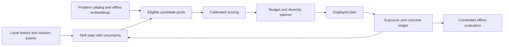

# CFChart recommender improvement plan

Prepared 2026-11-13 against commit `722873b`. Status: shadow instrumentation prototype; not a release of the adaptive recommender.

Implementation checkpoint (2026-11-13): `src/recommender/features.ts` builds first-attempt candidate features from a per-user history summary prepared once per ranking call. `src/recommender/inference.ts` evaluates the research tree artifact with a deployment guard. `candidates.ts` attaches the optional historical-acceptance prediction to planned problems; at this checkpoint, it did not affect ranking. Three fixture probabilities match the Python export. The timer mirrors start, pause/resume, hint, and reset actions to the per-handle local session ledger, including ordinary problems outside today's plan. Displayed recommendations are recorded separately from assignments, and practice-data export includes a descriptive impression-to-outcome summary. Full tests, typecheck, package build, and packaged UI smoke checks passed at that checkpoint. Browser validation of session transitions across page changes/tabs and an episode-level parity audit remain release checks for this instrumentation. The summary is not a causal policy estimate. Semantic retrieval, learned review/time models, controlled policy evaluation, and a representative prospective learning outcome study remain future work. The bundled model is explicitly marked `deploymentAllowed: false`.

The recommendation policy is now `adaptive-baseline-v2`: it prefers problems from contests in the last three years when that pool can fill the session, then falls back to older rated problems when it cannot. This reduces reliance on ratings assigned under older problem-setting norms without claiming that age alone recalibrates difficulty.

## Recommendation

Build a local adaptive tutor that chooses useful practice for the learner's available time. Combine calibrated outcome prediction, semantic problem representations, evolving skill estimates, and measured policy improvement. Use large models offline to enrich the problem catalog; serve compact models and cached representations in the extension.

The goal is better independent performance on unseen problems after practice. Immediate acceptance, recommendation clicks, and contest rating changes are supporting measurements with different meanings. Public acceptance data can bootstrap prediction; prospective practice data must establish educational benefit.

## Handoff for the next agent

Read this document first, then inspect `git status` and the checkpoint below. A Codeforces contest is **not required** for the first useful evaluation: ordinary recommended-problem practice is enough to measure whether acceptance predictions track observed attempts and whether users independently solve displayed problems. Contest rating is optional, slower secondary evidence. Do not describe the shadow score as independent-solve probability.

The current implementation mainly collects measurements. It records problem timer sessions and explicit hint use, distinguishes displayed recommendations from generated assignments, attaches the research acceptance score to planned problems, and exports a descriptive impression/outcome summary. It does not improve the live ranking yet. The research model remains `deploymentAllowed: false`.

There is no defensible fixed day count for usefulness. Start with a descriptive read once several weeks of regular impressions and outcomes accumulate; use a powered prospective comparison before making a causal learning claim. If no or very few users opt in, report that evidence is insufficient rather than inventing a percentage. Before release, finish the listed code and parity work, exercise session/impression flows in a browser, and confirm the release package still passes the repository checks. This checkpoint is local and must be committed/pushed for an agent in a fresh checkout to see it.

## What exists today

| Component | Current behavior and implication |
| --- | --- |
| `src/recommender/candidates.ts`, `score.ts` | Gaussian preference around target difficulty, weak-tag bonuses, fixed review/upsolve bonuses, and fixed time allowances. `pSolve` is null. |
| `skill.ts`, `state.ts` | Rating anchor plus conservative feedback adjustments; topic gaps use acceptance rates without fully accounting for attempted difficulty. |
| `index.ts`, `scheduler.ts` | Greedy score per planned minute, diversity penalties, and bounded swaps. A strong starting point for constrained planning. |
| `policy.ts`, `dataBroker.ts` | Deterministic assignment records with probability 1; assignments are explicitly not impressions. These records cannot evaluate arbitrary alternative recommendations. |
| `ProblemTimerWidget.tsx`, `session.ts` | The visible timer uses separate storage rather than the broker session ledger. Duration preferences now persist, but session timing and assistance events are not integrated end to end. |
| `ProblemVerdictBar.tsx` | Accepted-problem feedback distinguishes independent and assisted solves. This UI does not collect unsuccessful sessions. |
| `bayesian.ts`, `retention.ts`, `time.ts`, `learning.ts` | Research primitives exist; retention, competing risks, and causal transfer claims remain unvalidated. |

The [top-10,000 experiment](../ml/TOP10000_MODEL_RESULTS.md) reports 830,926 attempt episodes and a roughly 236 KB boosted acceptance model. Later-time log loss improves from 0.2391 to 0.2229; unseen-user log loss improves from 0.2282 to 0.2092. Its native/export parity passed, but TypeScript feature parity and actual recommendation-policy evaluation are still missing. These are recorded experiment results, not a new rerun.

The cohort was selected for current high rating. Its earlier beginner histories do not substitute for a representative sample of current beginners. Acceptance labels also have variable follow-up, and problem metadata reflects collection time. Audit these limitations before reusing the reported scores as deployment evidence.

## Proposed architecture

Keep inference local and retain the current baseline as a fallback. Shared research uses explicit exports; collecting a large public cohort does not require uploading personal extension activity.

## Phase 1 — Reliable measurements and labels

Estimated engineering effort: 3–5 days. This is the dependency for personalized timing, review fitting, and policy experiments.

1. Introduce a versioned ledger with distinct assignment, display, open, session, and outcome records. Link them using decision, slate, session, problem, and learner identifiers. Store model/feature/catalog versions, decision time, available budget, and eligibility context.
2. Connect the visible timer to the broker session API. Persist raw elapsed milliseconds, pauses, resumes, duration changes, and explicit assistance markers. Support ordinary practice outside the recommendation list; the current broker rejects sessions absent from the plan. Test refreshes, navigation, repeat attempts, multiple tabs, and identity changes.
3. Preserve accepted-only solve outcome controls. Add session controls for interruption or ending an unsuccessful attempt. Timer expiry is an observation, not an automatic failure; time away from the page is not automatically active thinking. Keep unknown assistance unknown.
4. Make a displayed list different from a generated list. Emit impressions when the recommendation UI is actually visible; deduplicate rerenders and retries. Allow outcomes to arrive later without overwriting earlier attempts.
5. Define separate targets: public acceptance within a fixed observation window; independently solved within a measured session budget; assistance/stop events; delayed recall; and unseen-problem transfer. For the public model, compare predeclared 1-day and 7-day horizons on development data, then freeze one. Incomplete follow-up is censored or excluded under a declared rule. Never label unattempted problems as failures.

Acceptance gate: deterministic event replay, migration from existing ledgers, complete joins in controlled browser scenarios, and an export report showing missingness and censoring. Keep outcome measurement optional and report the resulting selection bias.

## Phase 2 — Bring the strongest existing model into shadow evaluation

Estimated effort: 3–5 days, after Phase 1; label auditing can begin immediately.

Implement `src/recommender/features.ts`, `inference.ts`, and a dedicated model registry. Reproduce all seven boosted features from `ml/recommender/boosted_train.py`, including the exact episode grouping, rolling windows, historical ratings, missing values, float conversions, and calibration transform. Do not substitute `globalTheta` for the historical-rating feature without retraining.

Use shared Python/TypeScript fixtures at rolling-window boundaries, with duplicate submissions, same-time events, unrated users, missing tags, and new users. Compare final calibrated probabilities as well as raw tree scores. Distinguish the recommender registry from the official-rating forecast model registry.

Run shadow scoring locally: calculate candidate predictions while the current policy still chooses the displayed plan. Measure latency, disagreements, and calibration on subsequently observed attempts. Shadow data describes predictions on observed actions; it cannot prove the outcomes of unchosen actions.

Prototype a ranker using difficulty suitability, topic coverage, review urgency, and calibrated acceptance as an auxiliary feature. Maximizing acceptance alone would overselect easy problems. Reserve budget for a declared session purpose and use evidence-based explanations such as “Practices a topic with limited recent independent evidence.” Public acceptance predictions must never be labeled “chance of solving independently in 30 minutes.”

## Phase 3 — Semantic problem understanding

Estimated effort: 5–8 days for an offline prototype and evaluation set.

Use Qwen3 Embedding as an initial candidate for representing problem statements and normalized technique descriptions; compare it with a smaller encoder and a tags/text baseline. The 2025 primary report covers multilingual embedding and code retrieval. Its benchmark results establish a candidate technology, not Codeforces recommendation quality. [Qwen3 Embedding report](https://arxiv.org/abs/2506.05176).

Build a versioned offline catalog from available, permitted problem text. An offline language model may propose technique labels, prerequisites, and evidence spans. Review a stratified sample manually, track confidence/provenance, and exclude unsupported annotations. Keep statement-only and editorial-enriched representations separate so solution knowledge does not leak into purported learner-state evidence or visible hints.

Ship quantized vectors or precomputed nearest neighbors, rather than a large encoder in every browser. Start with 128–256 dimensions and benchmark retrieval accuracy after compression. Use exact vector search after eligibility filtering until catalog size and measured latency justify an approximate index.

Create candidate pools for weak techniques, recent-contest upsolves, due reviews, and related unseen transfer problems. Similarity must identify a technique across different stories without repeatedly choosing near duplicates. Newly released problems fall back to rating/tags until their catalog representation is available.

Gate: a held-out, human-judged set of at least 300 problem pairs spanning rating bands and techniques; measure relevant-neighbor precision, duplicate rate, prerequisite accuracy, and downstream ablations. This is an initial engineering check, not proof of educational impact.

## Phase 4 — Skill, memory, and time models

Estimated effort: 5–10 days for prototypes; validation depends on new session data.

**Dynamic knowledge tracing.** Start with the existing Bayesian ability primitives and difficulty-adjusted topic estimates, then compare a small sequence model on the same splits. Track uncertainty, recency, and evidence source; keep public acceptance separate from explicit independent outcomes. Shrink sparse topic estimates toward the global prior. Learn prerequisite effects only where validated; distinguish graph edges proposed by an LLM from empirically supported dependencies.

Evaluate a compact attention-based knowledge tracer as a challenger. A May 2026 programming knowledge tracing re-evaluation found that temporal ordering and experimental configuration can substantially reduce apparent advantages of more complex models. This supports strict baselines and sequence audits before choosing the architecture. [ITS 2026 study](https://arxiv.org/abs/2605.04727).

**Personalized reviews.** Compare the current 3/7-day rules, fitted half-life regression, and an FSRS-inspired model using difficulty, stability, and recall probability. FSRS models recall timing; adapting it to programming is a hypothesis requiring repeated independent review data. Fit programming parameters rather than importing flashcard defaults as validated values. Re-solving the same task measures retention; solving a related unseen task measures transfer. [FSRS author documentation](https://github.com/open-spaced-repetition/awesome-fsrs/wiki/ABC-of-FSRS).

**Time estimates.** Begin with regularized time quantiles when measured sessions are sufficient. Introduce competing solve/assistance/stop risks only after event counts and calibration justify them. Record interruptions and censoring explicitly. Treat the user's preferred timer duration as a requested allowance, not their observed solve time or the entire daily budget. Reconcile a changed allowance with the plan's remaining budget.

Use compact TypeScript inference for trees and Bayesian updates. If the sequence challenger earns deployment, benchmark a quantized ONNX model with a CPU/WASM path; WebGPU is optional acceleration and must be tested separately in Firefox and Chromium extension contexts. [ONNX Runtime Web documentation](https://onnxruntime.ai/docs/tutorials/web/).

## Phase 5 — Learn which recommendations help

Estimated effort: 4–7 days for experiment plumbing, followed by a data-dependent pilot.

Begin with a tightly bounded contextual bandit: randomize one designated recommendation slot among eligible near-tie candidates while freezing the other slots. Use an explicit categorical mixture with a small exploration rate, initially 5% as a proposed pilot setting. Persist the draw and chosen action so refreshes do not rerandomize the plan.

Log the entire supported action set, its exact probabilities, context, fixed slate, and displayed position. Extend the current probability-1 type and policy versioning. Probability must describe the final displayed decision: do not sample and then silently swap or filter the result in the scheduler. Enforce budget and eligibility before sampling and pin that slot through subsequent optimization.

Evaluate with user-separated cross-fitting, doubly robust estimates, overlap checks, importance-weight diagnostics, and user-cluster confidence intervals. The existing `ml/recommender/evaluate.py` is a starting point. These estimates concern supported one-step decisions; deterministic old logs do not identify alternative policies, and the single-slot experiment does not validate arbitrary whole-slate changes. [Doubly robust policy evaluation](https://arxiv.org/abs/1103.4601).

For educational benefit, run a prospective user-level randomized comparison after the measurement pilot. Use independently solved, previously unseen anchor tasks at 14/28 days, matched by initial ability and technique. Rotate a frozen assessment pool to reduce memorization; do not use the six hardcoded anchor examples in `learning.ts` as a validated assessment bank. Declare sample size from pilot variance and a minimum useful effect, accounting for repeated measurements and attrition. With only personal usage, report a descriptive pilot and uncertainty rather than population-level causal gains.

Track uptake, independent completion, assistance, interruptions, return rate, time-budget overruns, and missing outcomes as supporting metrics. Contest rating is a longer-term secondary outcome affected by participation. Reward weights remain provisional until linked to measured transfer.

## Evaluation and promotion gates

The following thresholds are proposed engineering targets to preregister before new experiments; they are not achieved results.

| Area | Proposed gate |
| --- | --- |
| Data | Past-only feature construction; fixed label maturity; separate train/calibration/test periods; disjoint unseen users; representative beginner and inactive-user cohorts. |
| Generalization | Additional unseen-problem/contest-family evaluation; audit collection-time tags/ratings; no tuning on the already examined top-10k holdouts. |
| Predictor | At least 3% relative log-loss improvement over the strongest comparable baseline on both later-time and unseen-user tests; Brier score noninferior; calibration error below 0.03 with reliability plots. Compare identical target definitions. |
| Subgroups | Report rating bands, sparse histories, problem age, and activity levels with confidence intervals. A subgroup with inadequate evidence remains unvalidated; investigate any greater than 5% relative log-loss regression. |
| Runtime parity | Maximum calibrated probability error below 1e-6 for tree inference on shared fixtures; independently set and validate tolerance for a quantized challenger. |
| Runtime budget | Target p95 warm ranking below 150 ms for 500 candidates on a declared reference laptop, incremental model/catalog assets below 10 MB, and incremental working memory below 50 MB. Measure startup and history rebuild separately. |
| Product invariants | No solved tasks outside intentional reviews, active-contest leaks, duplicated tasks, budget violations, cross-handle state, or broken pinned sessions. |
| Policy | Adequate action overlap and effective sample size for offline diagnostics; powered prospective evidence for claimed learning improvements. Missing outcomes remain visible in the analysis. |

Use ablations in this order: existing rules; calibrated tree features; Bayesian skill; semantic representations; learned review/time components; bandit policy. Evaluate the sequence model against the best simpler combination. Keep independent feature flags and a schema-versioned baseline rollback; missing/corrupt artifacts or incomplete histories must fail safely.

## Delivery order and larger-model decision

The first milestone is Phases 1–2: a trustworthy ledger and a parity-checked acceptance model running in shadow mode. The second adds semantic retrieval and validated skill estimates. The third adds reviews, timing, and an opt-in experiment. Expect roughly 4–7 engineering weeks for all prototypes with one developer, plus collection and evaluation time; this is a planning estimate, not a promised release date.

A small HSTU-style sequential recommender is a later research challenger once exposure histories are adequate. HSTU demonstrates sequence modeling at industrial scale, but its published gains do not establish suitability for CFChart's small, biased cohort or educational objective. Benchmark a reduced model and distillation only if simpler approaches plateau. [HSTU paper](https://arxiv.org/abs/2402.17152).

The immediate implementation tickets are: ledger v2 and timer integration; label-horizon audit; shared feature fixtures; TypeScript calibrated-tree inference; shadow comparison report. Those deliver useful infrastructure before spending substantial compute on a new architecture.
